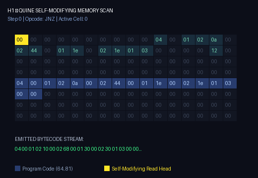
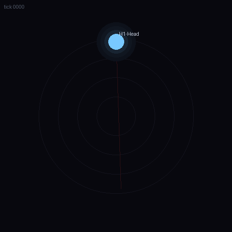
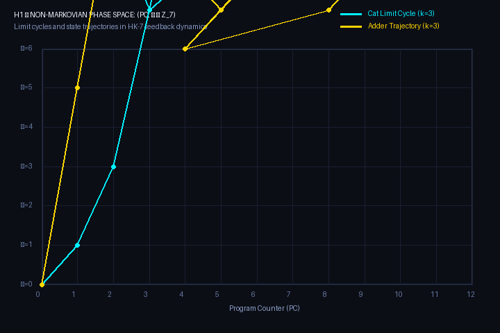

# H1 — Lenguaje Hostil No-Markoviano (HK-7)

> **Estado**: Implementado (intérprete + sintetizador)  

## Resumen

H1 es un lenguaje de programación donde **la ejecución depende de los últimos k estados previos**. No es markoviano: el opcode efectivo en cada paso deriva del opcode escrito más la suma de los últimos k opcodes efectivos.

```
op_efectivo = (op_escrito + Σ_{i=1..k} op_efectivo_{t-i}) mod 7
```

- **k=0**: máquina de registros base (7 instrucciones, sin deriva)
- **k>0**: deriva no-markoviana con feedback loop (el historial de opcodes efectivos altera los siguientes)

## ISA — HK-7 (7 instrucciones, encoding fijo 3 celdas)

| Opcode | Nombre | Aridad | Semántica |
|--------|--------|--------|-----------|
| 0 | HALT | 0 | Detiene la máquina |
| 1 | INC a | 1 | `mem[a] = (mem[a] + 1) % 256` |
| 2 | DEC a | 1 | `mem[a] = (mem[a] - 1) % 256` |
| 3 | JZ a o | 2 | `if mem[a] == 0: pc = o` |
| 4 | JNZ a o | 2 | `if mem[a] != 0: pc = o` |
| 5 | IN a | 1 | `mem[a] = input_buffer[ptr++]` (0 si EOF) |
| 6 | OUT a | 1 | `output_buffer.append(mem[a])` |

**Encoding**: cada instrucción = 3 celdas `(op, a, o)`. Operandos `a,o` son literales y **no derivan**. Solo el opcode deriva.

## Deriva: modo EFECTIVO (feedback loop)

El historial `H` guarda los **opcodes efectivos ya ejecutados**, no los escritos. Esto crea un bucle de realimentación genuino:

```
Paso 1: H=[]        -> op_eff = op_wr
Paso 2: H=[op1_eff] -> op_eff = (op_wr + op1_eff) mod 7
Paso 3: H=[op1,op2] -> op_eff = (op_wr + op1_eff + op2_eff) mod 7
...
```

Consecuencia: **un cambio en el paso 3 altera todos los opcodes posteriores en cascada**. No es preprocesable estáticamente; un compilador no puede precalcular la deriva porque depende del camino de ejecución real.

## Sintetizador (inversión determinista)

Dado un programa objetivo (secuencia de opcodes EFECTIVOS deseados), el sintetizador computa la fuente:

```
op_escrito = (op_deseado - Σ H) mod 7
```

Con deriva EFECTIVA esto es **determinista O(n)**: cada paso tiene solución única porque `H` ya se conoce (se construye izquierda→derecha).

## Síntesis de Bucles Estacionarios (Teorema del Bucle Armónico)

En bucles (`cat`, `adder`, `truth_machine`), una instrucción en la segunda pasada se enfrenta a un historial `H` diferente al de la primera vuelta. Para evitar que el bucle diverja, `src/h1/harmonic.py` implementa el **Teorema del Bucle Estacionario**:

1. **Condición de Contorno Cíclica:**
   En régimen estacionario de período $L \ge k$, el historial antes de ejecutar la instrucción $j$ siempre coincide con las $k$ instrucciones previas en el ciclo:
   $$\Delta_{cíclico}(j) = \sum_{i=1}^k e_{(j-i) \pmod L} \pmod 7$$
2. **Opcode Escrito Resonante:**
   $$w_j = (e_j - \Delta_{cíclico}(j)) \pmod 7$$
3. **Preámbulo de Sincronización:**
   Antes de entrar al bucle, una secuencia de sincronización prepara el historial de $k$ pasos para que coincida exactamente con la cola del bucle $[e_{L-k}, \dots, e_{L-1}]$.

El bucle se convierte en un **atractor periódico exacto en $\mathbb{Z}_7$** que puede ejecutarse un número arbitrario de iteraciones sin sufrir desfasaje.

## Corpus Canónico de Demostración (Los 6 Programas de Malbolge)

Implementados en `src/h1/classic_programs.py` y verificados bajo la suite de pruebas:

| Programa | Archivo | Descripción | k Verificados |
|---|---|---|:---:|
| **1. Hello World** | `hello_world_k*.h1` | Imprime `"Hello, World!\n"` y se detiene limpiamente. | 0, 1, 3 |
| **2. Cat** | `cat_k*.h1` | Bucle armónico que lee bytes hasta EOF (0) y los retransmite. | 0, 1, 3 |
| **3. Truth Machine** | `truth_machine_k*.h1` | Entrada 0 $\to$ imprime 0 y HALT. Entrada 1 $\to$ bucle armónico infinito imprimiendo 1. | 0, 1 |
| **4. Adder** | `adder_k*.h1` | Lee operandos $A$ y $B$, decrementa $B$ e incrementa $A$, emite $A + B$ y HALT. | 0, 1, 3 |
| **5. Digital Root** | `digital_root_k*.h1` | Calcula la raíz digital iterada $1 + ((N - 1) \pmod 9)$ (0 si $N = 0$). | 0, 1 |
| **6. Quine** | `quine_k*.h1` | Emite su propia representación de bytecode bit por bit idéntica. | 0, 1 |

Generar el corpus completo:
```bash
python examples/build_classic_suite.py
```

## 🌌 H1Art — Geometría No-Markoviana y Visualización con FLOW

La dinámica de realimentación no-markoviana de H1 no es una simple traza secuencial: el vector de estado $\vec{h} = (h_{t-k+1}, \dots, h_t) \in (\mathbb{Z}/7\mathbb{Z})^k$ habita de forma natural sobre un **hiper-toroide discreto $k$-dimensional $\mathbb{T}^k$** de $7^k$ estados.

Con el motor de renderizado de **FLOW**, proyectamos las trayectorias de ejecución, atractores y escaneos de memoria de H1:

| Toroide 3D de Estados $(\mathbb{Z}_7)^3$ (Cat $k=3$) | Escaneo de Memoria del Quine ($k=1$) |
|:---:|:---:|
|  |  |
| **Atractor periódico en el 3-toro de 343 nodos** | **Cabezal auto-modificante emitiendo su código** |

| FLOW Cinematic (Cat $k=3$) | FLOW Orbit (Cat $k=3$) |
|:---:|:---:|
|  |  |
| **Estelas cinemáticas en el plano de estados** | **Mapeo orbital circular de memoria** |

### Espacio de Fases Cilíndrico: $(PC, \Delta \in \mathbb{Z}_7)$
Trayectorias y ciclos límite de Cat y Adder en el cilindro discreto de fases:

<p align="center">
  
</p>

Generar todas las visualizaciones:
```bash
python visualizer/render_h1_art.py
```

## 🔬 Teoría y Experimentos Avanzados: Levantamiento de Estados, Automodificación y Estabilidad

El reporte completo con derivaciones matemáticas y evidencia empírica se encuentra en [`experiments/HOSTILE_EXPERIMENTS_REPORT.md`](experiments/HOSTILE_EXPERIMENTS_REPORT.md).

### 1. El Teorema del Levantamiento Markoviano (State-Space Lifting)
- **Falsación Markoviana Clásica:** Si un observador modela a H1 sobre el espacio de estados clásico $\mathcal{S}_{classical} = (PC, M)$, el sistema **no es markoviano**. Dos ejecuciones con idéntico PC, idéntica memoria e idéntico programa bifurcan hacia instrucciones efectivas completamente distintas ante historiales previos disjuntos:
  - Con $H_A = [0]$ ($\Delta = 0$): la instrucción escrita `HALT 10 0` ejecuta **`HALT`** inmediatamente.
  - Con $H_B = [1]$ ($\Delta = 1$): la misma instrucción ejecuta **`INC 10`** y continúa su ejecución activa.
- **Levantamiento Formal:** Al incluir los últimos $k$ opcodes efectivos dentro del estado, definimos el **espacio de estados ampliado**:
  $$\mathcal{S}^* = (PC, M, \mathbf{h}_k) \in \mathbb{N} \times (\mathbb{Z}_{256})^{256} \times (\mathbb{Z}_7)^k$$
  Sobre $\mathcal{S}^*$, el operador de transición dinámico $T: \mathcal{S}^*_t \mapsto \mathcal{S}^*_{t+1}$ es **estrictamente determinista y markoviano de orden 1**.

<p align="center">
  
</p>

### 2. Estabilidad Asintótica de Bucles Armónicos (10,000 Iteraciones)
Sometido a prueba de estrés sobre 10,000 caracteres de entrada (40,003 pasos), el bucle estacionario de `Cat (k=1)` demostró una tasa de deriva de fase de **0.0000000000**, manteniendo de forma inmutable su ciclo límite periódico $\Delta(t) \in [4, 5, 3, 6]$:

<p align="center">
  
</p>

### 3. Automodificación Von Neumann como Mecanismo de Punteros Dinámicos
Aunque la separación `PROGRAM_OFFSET = 64` aísla los datos iniciales, el intérprete permite lecturas y escrituras sin restricción en todo el espacio de memoria. Dado que la ISA de H1 **carece de direccionamiento indirecto** (`@a` o `[ [a] ]`):
> **La automodificación del operando de la instrucción en memoria (`INC 65` o `INC 68`) es el ÚNICO mecanismo de H1 para implementar punteros dinámicos y recorrer estructuras de datos indexadas.**

### 4. Taxonomía de Quines
- **Quine Asistida por Precarga (`preload_quine_memory`):** Almacena el bloque de reflexión en memoria de datos ($0..63$) desacoplado del puntero de código, logrando reproducción bit a bit idéntica (PASS).
- **Quine Autónoma Von Neumann:** Análisis de punto fijo algebraico mínimo ($A=8, B=9 \implies L=24$ instrucciones, 72 bytes). Al barrer la memoria de código, el puntero colisiona con el byte 58 (`mem[122]`), documentando el dilema del observador modificado en tiempo de ejecución.

---

## Archivos

```
H1_hostile_language/
├── src/h1/
│   ├── isa.py            # ISA, encoding, derive_opcode
│   ├── interpreter.py    # Máquina Von Neumann, step(), run(), trazas completas
│   ├── harmonic.py       # Teorema del bucle estacionario armónico
│   ├── classic_programs.py # Los 6 programas canónicos de Malbolge
│   └── synth.py          # Sintetizador lineal O(n)
├── experiments/
│   ├── run_hostile_experiments.py   # Suite de experimentación formal
│   ├── HOSTILE_EXPERIMENTS_REPORT.md # Reporte científico exhaustivo
│   ├── history_bifurcation.png      # Gráfico de bifurcación no markoviana
│   └── harmonic_stability_10k.png   # Gráfico del ciclo límite asintótico
├── visualizer/
│   └── render_h1_art.py  # Renderizador FLOW & H1Art (GIFs y proyecciones 3D)
└── tests/
    ├── test_h1.py        # Tests del lenguaje base
    ├── test_classic_programs.py     # Tests del corpus de 6 programas
    └── test_markov_and_self_modification.py # Tests de no-markovianidad y automodificación
```

## Ejecución

```bash
# Tests
python tests/test_h1.py

# Generar ejemplos
python examples/build_examples.py

# Uso directo (con el paquete instalado: pip install -e .)
from h1.isa import Instruction, Opcode
from h1.synth import build_hello_world_k0, synthesize_program
from h1.interpreter import create_machine, step, preload_memory_for_hello

target = build_hello_world_k0()
source = synthesize_program(target, k=3)
state = create_machine(source, mem_size=128)
preload_memory_for_hello(state.memory)
while step(state, k=3):
    pass
print(''.join(chr(c) for c in state.output_buffer))  # "Hello World\n"
```

## Trazas

El intérprete emite trazas paso a paso con:
- opcode escrito
- historial H (últimos k opcodes efectivos)
- delta de deriva (ΣH)
- opcode efectivo
- memoria antes/después
- PC siguiente, output/input, halted

```
PC | WrOp | Hist | Δ | EfOp |  a  |  o  | Out | In | PC' | Halt
----------------------------------------------------------------------
 0 |    5 |      |  0 |  IN  |  10 |   0 |   - | 65 |   1 | False
 1 |    3 |  5   |  5 |  JZ  |  10 |   4 |   - |  - |   2 | False
 2 |    6 |  5,3 |  1 |  OUT |  10 |   0 |  65 |  - |   3 | False
 3 |    4 |  5,3,6| 14 |  JNZ |  10 |   0 |   - |  - |   0 | False
...
```

## Programas de ejemplo

| Programa | Descripción | k probados |
|----------|-------------|------------|
| `hello_k*.h1` | "Hello World\n" (OUT desde memoria pre-cargada) | 0,1,3,7,16 |
| `cat_k*.h1` | cat: IN→OUT loop hasta EOF | 0,1,3 |
| `echo_k*.h1` | IN→OUT→HALT | 0,1,3 |

**Nota**: con `k>0`, los bucles (`cat`) tienen comportamiento divergente por deriva acumulada entre iteraciones. El sintetizador garantiza que la **primera pasada** por cada instrucción produce el opcode efectivo deseado.

## Decisiones de diseño clave

1. **Deriva EFECTIVA** (no escrita): feedback loop genuino, no preprocesable.
2. **Operandos no derivan**: solo opcode. Encoding fijo 3 celdas evita desalineación.
3. **Memoria unificada con offset**: programa en `offset=64`, datos en `0..63`. Evita auto-modificación accidental.
4. **7 opcodes, mod 7**: grupo cíclico, deriva siempre válida.
5. **Sintetizador lineal O(n)**: no BFS, solución única determinista por paso.

## Queda fuera (experimento separado E25)

- Índice de hostilidad cuantitativo
- Curva H(k) y comparación con Malbolge
- Benchmarks de "dificultad de programación"

Esto es el **lenguaje base H1** (intérprete + sintetizador). El experimento E25 mide propiedades sobre este lenguaje.